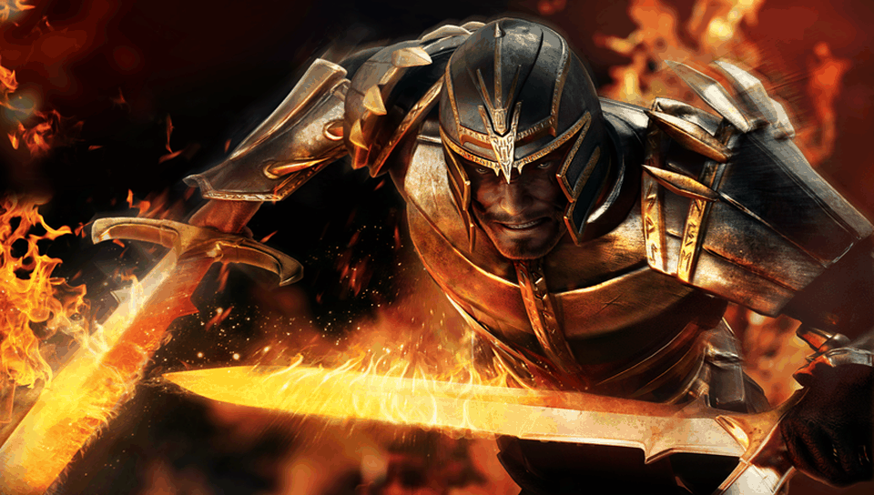

<h1 align="center">
  <br>
  Dungeon Hunter 3 · PS Vita Port
</h1>

<p align="center">
  <b>Native port of Dungeon Hunter 3 (Gameloft) for PlayStation Vita and PlayStation TV.</b>
</p>

<p align="center">
  
  
  
  
  
  
</p>

<p align="center">
  <a href="#-description">Description</a> •
  <a href="#-features">Features</a> •
  <a href="#-controls">Controls</a> •
  <a href="#-installation">Installation</a> •
  <a href="#-known-issues">Known Issues</a> •
  <a href="#-building-from-source">Build</a> •
  <a href="#-credits">Credits</a>
</p>

---

## 📖 Description

A native port of Gameloft's **Dungeon Hunter 3** (Android, v1.5.2c) to the PlayStation Vita, built on
the so-loader technique: the original Android `libDH3.so` is relocated and run directly on the Vita, with a
[FalsoJNI](https://github.com/v-atamanenko/FalsoJNI)-based bridge standing in for the parts of the
Android runtime the game calls into (Java callbacks, file system, OBB, input, audio, video, IME),
rendering through a patched [vitaGL](https://github.com/Rinnegatamante/vitaGL) built from source.

**This repo is loader/bridge source code only.** It does not contain, and will never contain,
Gameloft's copyrighted game assets, APK, OBB or `.so` binaries. See
[Getting the game data](#-installation) for what you need to supply yourself.

---

## 🎮 Status & Playability

**Status: Playable (v1.0.0 "First Light")**

Verified on real hardware: intro video, menus, character creation (with the Vita's on-screen keyboard), tutorial,
dungeon combat, all four classes rendering with their real textures, physical controls, and saves that survive a
reboot. The game holds **30 FPS** (the original Android frame cap) in normal play.

Known open issues:

1. **Short FPS dips (~27 fps)** while the game streams monsters/effects mid-level. Mitigated (disk probes for
   non-existent paths are short-circuited, per-asset logging removed); the next lever is reporting a "mid" device
   tier instead of "high" (see `RELEASE_NOTES.md`).
2. **Debug builds log a lot** (`DEBUG_SOLOADER`): every file open, texture upload and a few bounded shader
   diagnostics. Use a Release build for playing.
3. **Online features** (Gameloft Live, IGP store, social, tracking) are stubbed: the servers are gone and none of it
   is needed to play.

`port_progress.md` is the full paper trail: every crash, the log/dump that exposed it, the disassembly that
explained it, and the fix, one bug at a time. [`RELEASE_NOTES.md`](RELEASE_NOTES.md) summarizes it and holds the
v1.0.0 release text (boot and runtime, graphics, asset streaming, input and performance fixes).

---

## ✨ Features

| Feature | Status | Notes |
| :--- | :---: | :--- |
| Boots to gameplay | ✅ | Boots, plays and saves on a real PS Vita (v1.0.0). |
| Graphics / renderer | ✅ | vitaGL built from source with `[DH3]` patches; all four classes render with their real textures. |
| Audio & music | 🧪 | ❔ <!-- TODO: the README does not document audio results on console --> |
| Video / cutscenes | ✅ | Intro video plays on console. Optional: the intro is skipped unless `res/raw/logo_vita.mp4` is provided. |
| Physical buttons | ✅ | Cross / Square / Triangle / Circle, L / R, Start / Select verified with physical controls. |
| Analog sticks / camera | ✅ | Left stick move, right stick aim. Axes are invertible in `config.txt`. |
| Touch screen | ✅ | Front touch drives everything the HUD exposes; on-screen keyboard works for character creation. |
| Button remapping / port menu | 🟡 | Stick axes and FPS cap are set in `config.txt`; there is no in-game remap menu. |
| Save data | ✅ | Saves survive a reboot (verified on console). |
| Native trophies | ➖ | Not applicable: no trophies are implemented. |
| Languages | ➖ | ❔ <!-- TODO: not documented in the repo --> |
| Performance | 🟡 | Holds 30 FPS in normal play; short dips to ~27 fps while streaming mid-level. |
| Online / IAP / ads | ➖ | Gameloft Live, IGP store, social and tracking are stubbed (servers gone). |
| PS TV | 🧪 | The PS TV touchpad mapping (L2 / R2 / L3 / R3) is implemented; not documented as verified. |

Legend: `✅ Working (verified on console) · 🧪 Implemented, not yet verified on console · 🟡 Partial · ❌ Not working · ➖ Not applicable · ❔ Not documented yet`

---

## 🎯 Controls

The port presents the Vita to the game as an **Xperia Play with its gamepad slid open**, so the game uses its own
native gamepad scheme and on-screen prompts.

| Vita input | Xperia Play equivalent | In game |
| :--- | :--- | :--- |
| Left stick | Left touchpad | Move |
| Right stick | Right touchpad | Aim / ranged attack |
| D-Pad | D-Pad | Menu navigation |
| Cross / Square / Triangle / Circle | Cross / Square / Triangle / Circle | Attack, skills, back |
| L / R | L1 / R1 | R = health potion |
| START / SELECT | Start / Select | Pause / menus |
| Rear touch (left / center / right) | Touchpad zones | Move / **swap weapon** / aim |
| L2 / R2 / L3 / R3 (PSTV) | Touchpad center | Swap weapon |
| Front touch | Touch screen | Everything the HUD exposes |

Stick axes and the frame cap can be changed in `ux0:data/dungeonhunter3/config.txt` (created on first boot, missing
keys are added automatically):

```
setting_invertLeftX 0
setting_invertLeftY 1
setting_invertRightX 0
setting_invertRightY 1
setting_fpsCap 30
```

### ⚙️ Options

| Key | Default | Meaning |
| :--- | :---: | :--- |
| `setting_invertLeftX` | `0` | Invert the left stick on the X axis |
| `setting_invertLeftY` | `1` | Invert the left stick on the Y axis (the game reads the touchpad with Y up) |
| `setting_invertRightX` | `0` | Invert the right stick on the X axis |
| `setting_invertRightY` | `1` | Invert the right stick on the Y axis |
| `setting_fpsCap` | `30` | Frame cap (the original Android frame cap) |

---

## 📋 Prerequisites

To run this port on your PS Vita or PS TV, you will need:

1. A PS Vita / PS TV console running Custom Firmware (**Enso 3.60 / 3.65** recommended).
2. [**kubridge**](https://github.com/bythos14/kubridge) (`kubridge.skprx` in taiHEN's `*KERNEL`).
3. [**libshacccg.suprx**](https://github.com/Rinnegatamante/ShaRKBR33D/releases/latest) in `ur0:data/` (Sony's shader
   compiler; not redistributed here).
4. A legally owned copy of **Dungeon Hunter 3** for Android (v1.5.2c, `com.gameloft.android.ANMP.GloftD3HM`) with its OBB.

---

## 📦 Installation

### Getting the game data

You need to legally own **Dungeon Hunter 3** for Android (v1.5.2c, `com.gameloft.android.ANMP.GloftD3HM`) with its
OBB. Nothing of it is in this repo; `.gitignore` excludes it by design.

Copy to the Vita:

```text
ux0:data/dungeonhunter3/
├── libDH3.so                                    <- from the APK: lib/armeabi-v7a/libDH3.so
├── assets/                                      <- the APK's assets/ folder
├── res/                                         <- the APK's res/ folder
└── com.gameloft.android.ANMP.GloftD3HM/
    └── main.1501.com.gameloft.android.ANMP.GloftD3HM.obb
```

The OBB is also found directly in `ux0:data/dungeonhunter3/` or under `obb/<package>/`.

Optional intro: the APK's `res/raw/logo.mp4` is MPEG-4 Part 2, which SceAvPlayer can't decode; transcode it to
`res/raw/logo_vita.mp4` with the `ffmpeg` command documented in `source/main.c`. Without it the intro is simply skipped.

### Steps

1. Install the `dungeonhunter3.vpk` (title ID `PSVDH0003`) with VitaShell.
2. Copy the files above to `ux0:data/dungeonhunter3/`.
3. Launch the game. `config.txt` and, in Debug builds, `logs/` are created on first boot.

---

## 🐛 Known Issues

- **FPS dips** to about 27 fps while streaming monsters and effects mid-level (see [Status](#-status--playability)).
- **Debug builds** (`DEBUG_SOLOADER`) log every file open, texture upload and a few shader diagnostics: use Release to play.
- **Online features** (Gameloft Live, IGP store, social, tracking) are stubbed out.
- **Crash dumps** are written by the system to `ux0:data/` (not to the game folder). `port_progress.md` lists the logs
  and dumps behind each fixed crash.

---

## 🔨 Building from Source

### Prerequisites

- [VitaSDK](https://vitasdk.org/). `kubridge` stubs, FalsoJNI, so_util, libc_bridge and **vitaGL** are vendored under
  `lib/` (vitaGL is built from source with local `[DH3]` patches; see `lib/vitagl/VENDORED.md` and `README VITAGL.md`).
- On the Vita: [kubridge](https://github.com/bythos14/kubridge) and `libshacccg.suprx` (see [Prerequisites](#-prerequisites)).

### Compilation Commands

```bash
cmake -S . -B build -DCMAKE_BUILD_TYPE=Release
cmake --build build -j
```

VitaSDK's toolchain does not cope with spaces in paths: build from a space-free directory. The
psvita-port-toolkit CLI (`psvita-toolkit build` / `deploy` / `analyze`) used during development does that
automatically and also handles FTP deploys and crash-dump triage. `Debug` builds define `DEBUG_SOLOADER`
(verbose logs to `ux0:data/dungeonhunter3/logs/`).

---

## 📁 Project Structure

- `source/`: loader and bridge (`main.c`, `java.c`, `patch.c`, `video.cpp`, generated JNI stubs and table, `reimpl/`, `utils/`).
- `lib/`: vendored libraries (`falso_jni`, `fios`, `kubridge`, `libc_bridge`, `sha1`, `so_util`, `vitagl`).
- `extras/livearea/`: LiveArea assets (`icon0.png`, `bg0.png`, `pic0.png`, `startup.png`, `template.xml`).
- `PORTING_PLAN.md`: living plan. `port_progress.md`: bug-by-bug log. `RELEASE_NOTES.md`: release text.
- `README VITAGL.md`: how vitaGL is built and patched for this port.

---

## ☕ Support My Work

This project is **free** and will stay free. If you enjoy it, a tip from **$1** helps me keep porting games to the PS Vita:

<p align="center">
  <a href="https://ko-fi.com/metalsyntax"></a>
</p>

- **Ko-fi:** [ko-fi.com/metalsyntax](https://ko-fi.com/metalsyntax)
- **PayPal:** [paypal.me/MetalSyntax](https://paypal.me/MetalSyntax)
- **Bitcoin (BTC):** `133HdCsaWxdjTfmwpgGVykByhNBV338uRc`

**Ko-fi supporters get:**
- **Early access** to new ports before their public release (test builds of upcoming projects).
- **Data preparation scripts and step-by-step guides** to set up your own game files for each new port.
- A say in which games I port next.

> Game files are never distributed. You always need your own legally obtained copy of the game.

---

## 📜 Disclaimer

Dungeon Hunter 3 is © Gameloft. This project is an unofficial, non-commercial fan port and is not affiliated with or
endorsed by Gameloft. This software does NOT contain original game code, binaries, copyrighted graphics, or game
assets. The authors do not promote or condone piracy in any way. To play, you must provide your own legally obtained
copy of the game (APK and OBB).

---

## 👥 Credits

- [SoLoBoP](https://github.com/v-atamanenko) (Andy Nguyen, Rinnegatamante, Volodymyr Atamanenko): the so-loader
  boilerplate this project is built on, MIT licensed (see `LICENSE`).
- [FalsoJNI](https://github.com/v-atamanenko/FalsoJNI): the JNI bridge implementation.
- [vitaGL](https://github.com/Rinnegatamante/vitaGL) by Rinnegatamante: the GLES driver, built from source.
- [kubridge](https://github.com/bythos14/kubridge) by Bythos: kernel memory bridge.
- **Dungeon-Hunter-2-vita**: sibling port on the same Gameloft *glitch* engine; its vendored vitaGL and loader fixes
  were the starting point here.
- Dungeon Hunter 3 is © Gameloft.
- Special thanks to the PS Vita homebrew and porting community.

---

## 📄 License

The loader/bridge source code in this repository is MIT licensed (Copyright (C) 2021 Andy Nguyen), see
[LICENSE](LICENSE). vitaGL is under its own license (`lib/vitagl/COPYING*`). These licenses cover this project's own
code only, not Dungeon Hunter 3 itself.
